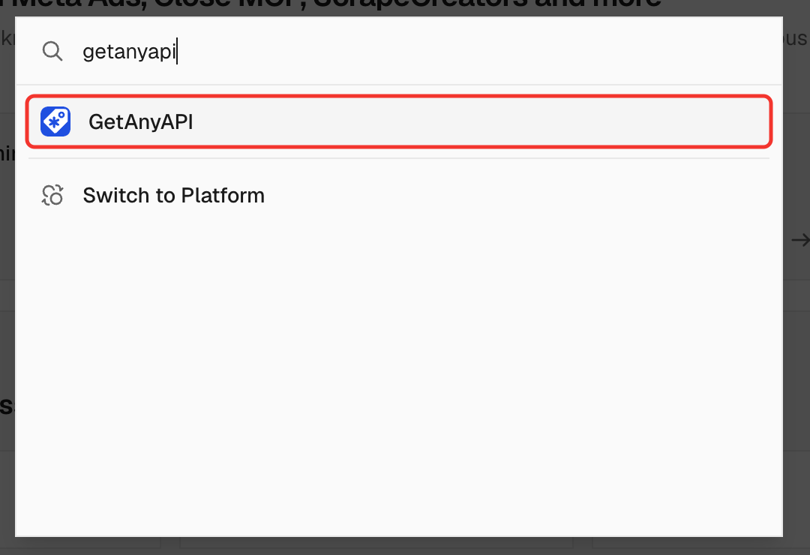
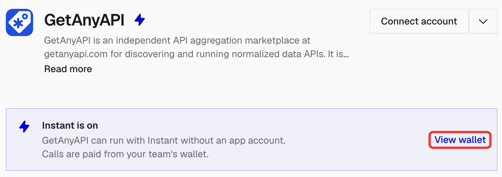
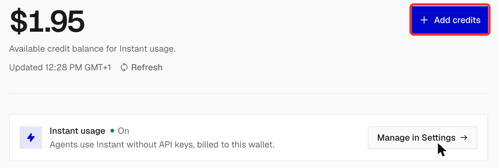
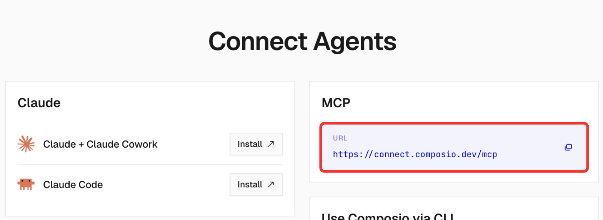
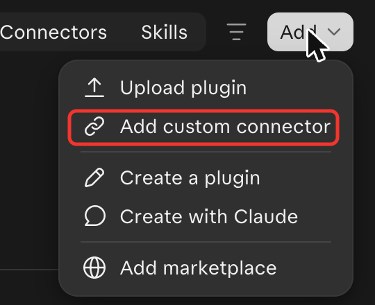
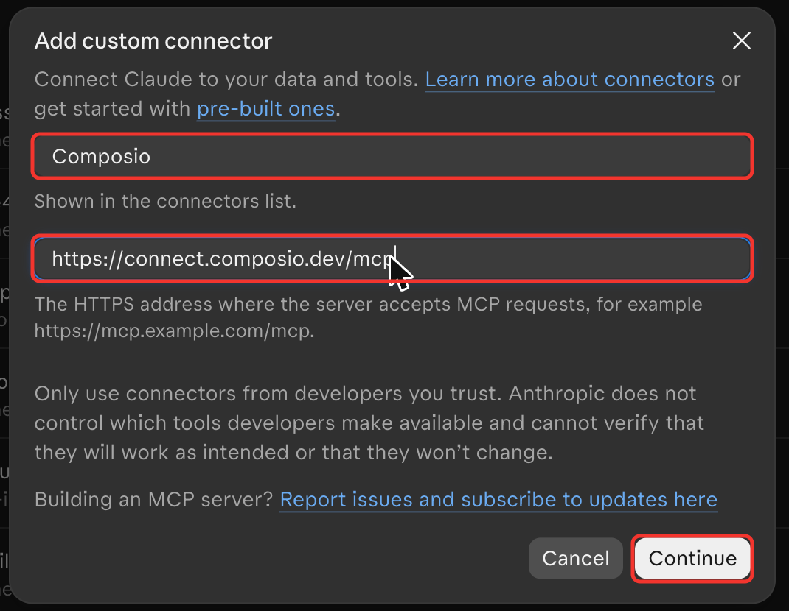

# Prospector Kit

`/prospector` finds people who liked your reels and follow you, writes a personal opener for each, and after you approve the list sends them from your Instagram and hands the chat to your SetDM AI.

It runs on YOUR computer, in YOUR Chrome, because Instagram already trusts that device and network. Never set it up on someone else's computer, a server or a VPN. If someone helps you on a call, they guide and you click. Nobody logs into your Instagram from their own device, that is how accounts get banned.

## Before you start (5 minutes, saves an hour)

- A Mac with Chrome, and your coaching Instagram logged in on that Chrome.
- setdm.app logged in on that same Chrome, your workspace selected.
- ONE Claude email. Use the same email in the Claude desktop app and in the Claude in Chrome extension. Signing in with a different email is the most common reason a setup stalls.
- A card to put $10 of credit in your Composio wallet (step 4).
- 45 to 60 minutes with nothing else open.

## Install (once)

Do the steps in this order. Each one has the mistake people make on it.

**1. Apple's developer tools (do this FIRST).** The kit needs git and Python, and a fresh Mac only has stand-ins that pop up an installer when something asks for them.
   - Open Terminal (Cmd+Space, type Terminal) and run: `xcode-select --install`
   - A window appears asking you to install. Click **Install** and accept the license. It is about 1 GB and takes 5 to 15 minutes.
   - The window can hide behind other windows, check the Dock for a new icon. If nothing appears after a minute, close Terminal, open it again and rerun the command.
   - Done when `xcode-select -p` prints a folder path. Do not go on before that.
   - If you skip this, setup.sh catches it: it says MISSING, opens the same installer for you and stops. Finish the install and run setup.sh again.

**2. Claude app, Code tab.** Install the Claude desktop app (claude.com/download) and sign in.
   - Open the **Code** tab. A normal Chat cannot run anything on your computer, so pasting the GitHub link into a chat does nothing useful.
   - Start a **new session** and choose a local folder at the bottom. If you have none, create a folder called Claude on your Desktop and pick it. Click **Trust** or **Allow** when it asks.
   - If it keeps asking you to sign in, you used a different email than the one on your Claude account. Log out and in with the right one.
   - The yellow "Notifications are turned off" banner is harmless, close it.

**3. Chrome.** Install the **Claude in Chrome** extension from the Chrome Web Store and sign in with the same Claude email. In that Chrome stay logged into instagram.com as your coaching account and into setdm.app. Keep using this Chrome for Instagram as normal.

**4. Composio (reads likers and profiles).** It runs on Composio's "Instant" mode: no app account and no API key, you just keep a small credit balance in your Composio wallet. The red boxes in the pictures are what you click or fill in.

   **4a. Account.** Go to composio.dev, click Get started, Continue with Google, and skip the onboarding questions.

   **4b. Find GetAnyAPI.** In the left menu click **Search**, type `getanyapi` and click the **GetAnyAPI** result.

   

   **4c. Check Instant is on.** The page shows a blue box that says **Instant is on** and "Calls are paid from your team's wallet". That is all you need. Do NOT click Connect account and do not look for an API key. Click **View wallet**.

   

   **4d. Add $10.** New wallets start with about $2. Click **Add credits** and add **$10**. That is enough for now, a full day of Prospector costs about 30 cents. Top up when the balance runs low.

   

   **4e. Copy the MCP link.** In the left menu click **Connect Agents**. Do NOT use the Install buttons next to Claude, they ask for an API key. Copy the link in the **MCP** box on the right: `https://connect.composio.dev/mcp`

   

   **4f. Add it to Claude.** In the Claude app click **Plugins** in the left menu (or Settings, then Connectors), click **Add**, then **Add custom connector**. The pictures are from claude.ai in a browser, the app has the same form.

   

   Type the name **Composio**, paste the link, click **Continue**, sign in with the same Composio account and allow.

   

   **4g. Check.** Composio now shows as a connected plugin in Claude. In the Composio dashboard the Wallet page lists each lookup the kit makes, so you can see what it spends.

   - There is no Instagram entry in Claude's own plugin list and you do not need one. The kit uses your logged-in Chrome for Instagram.
   - Use your own Composio account only, never someone else's: it can reach every app connected to it.

**5. The kit.** Paste this into the Code tab, with the repo link you were sent at the end:

   > Clone this public GitHub repo into my home folder with git and run its setup.sh. The repo:

   - If Claude downloads it as a zip instead, or setup.sh says "couldn't pull", updates will never work. Paste: "Replace my prospector-kit folder with a proper git clone of the same repo, then run setup.sh." Tools from step 1 must be installed first.
   - If Claude says python3 or git is missing, or only a dialog opens, go back to step 1.

**6. Check.** Open a new session and type `/prospector check`. It tells you anything that's missing, in one line each. Fix those and run it again until it is clean.

**7. Setup.** Type `/prospector setup`. Have ready: 10 Instagram handles of clients you closed in DMs, 3 openers you already send and like, and the handles of family, friends and clients it must never message. It also schedules the daily run at 07:30.

**8. First run.** Let it build one batch and read the list before you approve anything. Send a full-screen screenshot to whoever onboarded you if anything looks off.

## Every day

Your Mac on, Claude open. The day's list lands in `~/Prospector/<your handle>/batches/<date>/approval.md`. **You have to approve it every morning, nothing sends on its own.** Delete any row you don't want, type `/prospector send`, and leave the Instagram tab it's using alone while it sends. It ramps up on its own: 50 a day the first week, 75 the second, then about 100 (5 to 6 hours of slow sending spread through the day). If Instagram ever shows a warning it stops and drops back to 50.

## If something breaks

| What you see | What to do |
|---|---|
| Installer window never shows | Check behind other windows and the Dock, then rerun `xcode-select --install`. If it says the tools are already installed, they are, move on. |
| Claude says python3 or git is missing, or setup.sh says MISSING Apple developer tools | Step 1 is not finished. Wait for the installer, check `xcode-select -p` prints a path, then run setup.sh again. |
| Pasting the repo link into a chat does nothing | You are in Chat. Use the Code tab with a local folder chosen (step 2). |
| Stuck on sign in | Wrong email. Use the one your Claude account was made with, in the app and in the Chrome extension. |
| Composio asks for an API key | You used a shortcut or clicked Connect account. Neither is needed: Instant is on, no key. Close it and add the custom connector with the MCP link from Connect Agents (step 4). |
| `/prospector check` says Chrome is not connected | Open Chrome, make sure the Claude in Chrome extension is signed in with the same email, then check again. |
| `/prospector check` says Composio or GetAnyAPI is missing | Reconnect the custom connector in Claude. In Composio open Search, getanyapi, and check it says Instant is on, then open Wallet and check the balance is above zero. An empty wallet stops every lookup. |
| setup.sh says "couldn't pull" | It was installed as a zip. Do the git clone fix in step 5. |
| Instagram shows any warning or asks you to log in again | The kit stops by itself. Handle it yourself in Chrome, do not send for 48 hours, and tell whoever onboarded you. |

## Updates

Paste this into the Code tab now and then: "Run setup.sh in my prospector-kit folder." It pulls the latest version.
